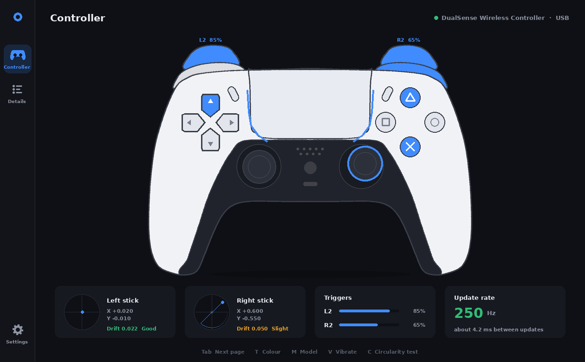
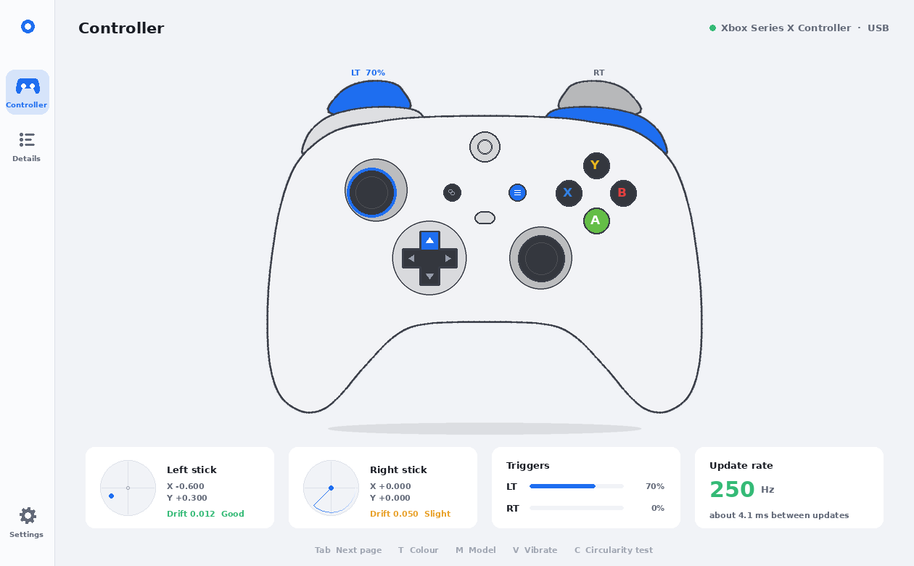
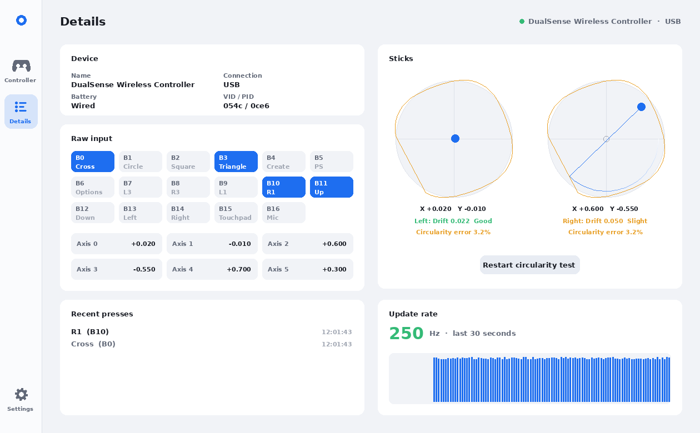
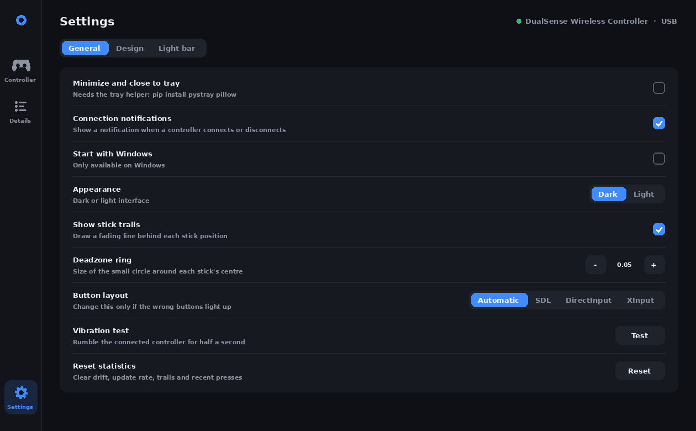
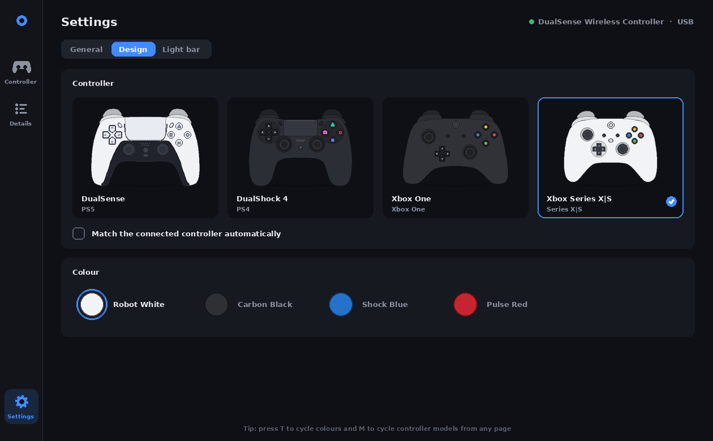
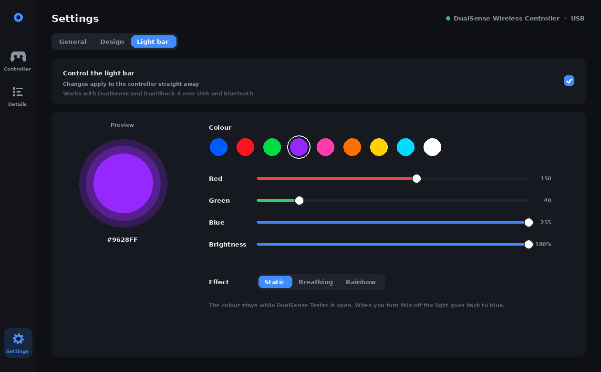

# Controller-Tester

**DualSense Tester** is a Windows desktop app for testing game controllers. It shows a live, flat 2D drawing of your controller that lights up as you press buttons, plus tools for stick drift, trigger travel, update rate and light-bar colour.

Supported controllers: **DualSense (PS5)**, **DualShock 4 (PS4)**, **Xbox One** and **Xbox Series X|S**.

> Personal / educational project. Not affiliated with or endorsed by Sony or Microsoft.



---

## Features

### Controller page
- Live 2D drawing of the controller. Every button, the D-pad, the touchpad click, L3/R3, the PS / Xbox button and the mic / Share button light up when pressed.
- Sticks move inside their slots; L2/R2 (LT/RT) triggers fill up from the bottom with a percentage label.
- Four quick read-outs: **left stick**, **right stick** (with drift rating), **triggers** and **update rate** in Hz (hertz, updates per second). A DualSense over USB (Universal Serial Bus) normally reports about 250 Hz.

### Details page
- Device info: name, connection (USB or Bluetooth), battery level and VID / PID (Vendor ID / Product ID).
- Raw input grid for every button and axis, named for the selected controller.
- Large stick plots with trails, deadzone ring and a **circularity test** (average error %).
- Recent button presses and a 30-second update-rate graph.

### Settings
| Tab | What's in it |
|---|---|
| **General** | Minimize and close to tray · Connection notifications · Start with Windows · Dark / Light mode · Stick trails · Deadzone ring · Button layout (Automatic, SDL, DirectInput, XInput) · Vibration test · Reset statistics |
| **Design** | Pick the controller drawing (DualSense, DualShock 4, Xbox One, Xbox Series X\|S), optionally match the connected controller automatically, and choose from four colours per controller |
| **Light bar** | Set the DualSense / DualShock 4 LED (Light-Emitting Diode) light bar: 9 presets, RGB (red, green, blue) sliders, brightness, and Static / Breathing / Rainbow effects |

### Desktop app behaviour
- Closing or minimizing hides the app to the **system tray**; right-click the tray icon to quit.
- Windows notifications when a controller **connects or disconnects** (including connection type and battery).
- Optional **Start with Windows** (opens straight into the tray).
- Settings are saved in `%APPDATA%\DualSenseTester\settings.json`.

| | |
|---|---|
|  |  |
|  |  |
|  | |

---

## Requirements
- Windows 10 or 11
- Python 3.10 or newer (tested with Python 3.14)
- Python packages in [`requirements.txt`](requirements.txt):
  - `pygame-ce` 2.5.6 or newer (2.5.6 added the light-bar function)
  - `pystray` and `pillow` (system tray icon and notifications)

> Use **pygame-ce** (Community Edition), not `pygame`. Regular pygame has no ready-made download for the newest Python versions, so `pip install pygame` tries to build it from source and fails.

## Quick start (run the script)
```bat
git clone https://github.com/abdulrahman7a1/Controller-Tester.git
cd Controller-Tester
pip install -r requirements.txt
python controller_tester.py
```

## Make it a desktop app (.exe with a shortcut)
Double-click **`Create Desktop Shortcut.bat`**. It:
1. installs pygame-ce, PyInstaller, pystray and Pillow,
2. builds `dist\DualSense Tester\DualSense Tester.exe` with the controller icon,
3. puts a **DualSense Tester** shortcut on your desktop.

Run it again whenever you update `controller_tester.py` (close the app first: right-click the tray icon → **Quit**).
If Windows SmartScreen warns about the new .exe, choose **More info → Run anyway**.

---

## Keyboard shortcuts
| Key | Action |
|---|---|
| `Tab` | Next page (Controller → Details → Settings) |
| `T` | Cycle controller colour |
| `M` | Cycle controller model |
| `V` | Vibration test |
| `C` | Start / restart the circularity test |
| `F1` | Cycle button layout |
| `Up` / `Down` | Deadzone ring size |
| `R` | Reset statistics |
| `Esc` | Quit |

## Troubleshooting
- **Controller not detected, or the wrong buttons light up:** close Steam and DS4Windows (they can take over the controller), then reconnect. If buttons are still wrong, change **Settings → General → Button layout** or press `F1`.
- **Light bar doesn't change:** needs pygame-ce 2.5.6+ (`pip install -U pygame-ce`) and a DualSense or DualShock 4. Xbox controllers have no colour light bar. The colour holds while the app is running.
- **No tray icon / notifications:** install the tray helper with `pip install pystray pillow`.
- **Update rate looks low:** move a stick continuously; Bluetooth usually reports less often than USB.

## How it works
- Input comes from SDL (Simple DirectMedia Layer) through pygame-ce. The app enables SDL's HIDAPI (Human Interface Device API) drivers for PlayStation controllers, so a DualSense reports all 17 buttons, including the touchpad click and mic button.
- Each controller is drawn from vector shapes traced from reference drawings, at 2x size and then smoothly scaled down, with cached parts so it runs at 60 frames per second while input is polled up to 1,000 times per second.
- The connection type, VID and PID are read from the controller's SDL GUID (Globally Unique Identifier).

## Project files
```
controller_tester.py         the app (single file)
dualsense.ico / .png         app and tray icon
Create Desktop Shortcut.bat  builds the .exe and makes the desktop shortcut
requirements.txt             Python packages
docs/screenshots/            images used in this README
```
